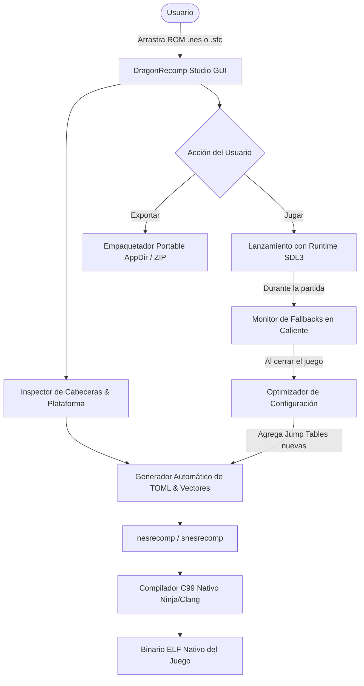

# DragonRecomp — Arquitectura Implementada y Especificación del Pipeline Gráfico Autónomo

Este documento consolida:
1. **Especificación del trabajo completado hasta la fecha** (Hitos M0 a S4: NES + SNES).
2. **Registro de las 4 ideas de automatización**.
3. **Especificación técnica del sistema objetivo**: Fusión de Auto-aprendizaje, Empaquetador Portable y GUI Drag & Drop.

---

## Parte 1: Especificación Técnica de lo Implementado (Hitos M0 – S4)

DragonRecomp es una plataforma de recompilación binaria estática a C99 con ejecución nativa en Linux y runtime acelerado en C++20 con SDL3.

### 1.1 Núcleo NES (Ricoh 2A03 / MOS 6502)
- **Desensamblador y Recompilador (`nesrecomp`)**:
  - Desensamblado recursivo partiendo de vectores `RESET`, `NMI`, `IRQ` y puntos de entrada TOML.
  - Generador C99 con eliminación de banderas muertas dentro de bloques básicos.
  - Detección estática de tablas de salto en línea (patrón `JumpEngine` en `$8E04` de Super Mario Bros. y derivados).
  - Emisión de funciones individuales `func_XXXX` y funciones por banco `func_BB_XXXX`.
  - Tabla de despacho `kRecompDispatchTable` con búsqueda binaria en $O(\log N)$.
- **Runtime 6502 (`nes_runtime`)**:
  - `CpuState`: acumulador A, registros X/Y, puntero de pila S, PC, ciclo maestro y banderas desempaquetadas.
  - Intérprete 6502 de referencia (151 opcodes oficiales + opcodes estables no oficiales). Pasa las 8,991 instrucciones de `nestest.log` de kevtris con cero diferencias.
  - Mecanismo de **Fallback Transparente**: cuando un salto indirecto `JMP ($xxxx)` cae en una dirección no compilada estáticamente, el runtime no crashea; ejecuta temporalmente el intérprete, registra la dirección en `fallback.log` y continúa la ejecución de forma imperceptible.
- **PPU 2C02 (Precisión por Dot)**:
  - Registros de desplazamiento Loopy (`v`, `t`, `x`, `w`) para scroll por píxel.
  - Evaluación de sprites (8x8 y 8x16) y cálculo de **Sprite-0 Hit exacto al dot** (indispensable para la barra de estado y el scroll de SMB).
  - OAM DMA `$4014` con retardo de 513/514 ciclos de CPU.
  - Renderizado RGBA8888 a 256x240 con paleta estándar de 64 colores.
- **APU 2A03**:
  - Canales de audio: Pulse 1 y Pulse 2 (con barrido de frecuencia por complemento a 1 y 2), Triangle (secuenciador de 32 pasos), Noise (LFSR de 15 bits) y DMC (lector DMA de muestras e interrupción).
  - Mezclador no lineal según curvas de nesdev, remuestreado a **48 kHz** vía `SDL_OpenAudioDeviceStream`.
- **Mappers Soportados**:
  - Mapper 0 (NROM), Mapper 1 (MMC1 / SxROM), Mapper 2 (UxROM), Mapper 3 (CNROM), Mapper 4 (MMC3 con interrupción por scanline A12 en dot 260), Mapper 40 (NTDEC 2722 / SMB2J con timer IRQ de 4096 ciclos y PRG-ROM en $6000-$7FFF), Mapper 99 (Vs. System con monedas y paletas RP2C04) y Mapper 189 (TXC/MMC3 con PRG de 32 KiB en $4100-$5FFF).

### 1.2 Núcleo SNES (Ricoh 5A22 / WDC 65816)
- **Recompilador 65816 (`snesrecomp`)**:
  - Rastreo estático del ancho de registros `(m, xf, e)` a través de `SEP`, `REP`, `CLC; XCE` y `SEC; XCE`.
  - Generación de múltiples variantes C99 de una misma función según el estado de las banderas: `func_BB_XXXX_mYxZ` o `func_BB_XXXX_e1` (modo emulación).
  - Emisión de llamadas de sondeo `runtime_poll(cpu)` en bifurcaciones hacia atrás para atender eventos de línea e interrupciones sin bucles activos.
- **Runtime y Bus SNES (`snes_runtime`)**:
  - 128 KiB de WRAM (`$7E:0000–$7F:FFFF`), puertos `$2180–$2183`.
  - Mapeo automático de ROMs LoROM (`$7FC0`), HiROM (`$FFC0`) y ExHiROM (`$40FFC0`) con eliminación opcional de cabeceras SMC de 512 bytes.
  - Multiplicador y divisor por hardware en registros `$4202–$4217`.
  - DMA de 8 canales (`$43x0–$43xA`, disparado por `$420B`) con 8 ciclos maestros por byte.
  - HDMA por scanline (`$420C`) en modos de tabla directo e indirecto.
  - Intérprete completo 65816 con aritmética binaria y **decimal BCD de 8 y 16 bits** en `ADC`/`SBC`.
- **S-PPU SNES**:
  - 64 KiB de VRAM, 512 B de CGRAM (256 colores BGR555) y 544 B de OAM (128 sprites).
  - Renderizador de scanlines con soporte de **Modos BG 0, 1, 2, 3, 4, 5 y 7**.
  - Transformación afín del **Modo 7** (matriz `M7A..M7D`, centro `M7X/M7Y`) y multiplicación con signo en `$2134–$2136`.
  - Composición de capas Main/Sub, recorte de ventanas 1 y 2, Color Math y brillo maestro.
- **Subsistema de Audio SPC700 + S-DSP**:
  - Intérprete de CPU SPC700 (256 instrucciones, temporizadores `$FA–$FF`, registros de comunicación `$F4–$F7`).
  - Emulación de la ROM de arranque IPL (64 bytes) que ejecuta con éxito el protocolo de subida (*uploader handshake*) en `$2140–$2143`.
  - S-DSP de 8 voces con decodificación ADPCM BRR, filtros de interpolación gaussiana, envolventes ADSR/GAIN y salida a 48 kHz en SDL3.

### 1.3 Suite de Validación
18 suites de CTest integradas que cubren desde operaciones matemáticas de CPU hasta la recompilación y arranque autónomo de *Super Mario Bros.* (NES), *Donkey Kong* (NES) y *Super Mario Bros. SNES* (HiROM 4 MB) sin fallbacks.

---

## Parte 2: Las 4 Ideas de Automatización

1. **Idea 1: CLI Unificado Zero-Config (`dragon run <rom>`)**:
   Detección de plataforma, autogeneración de TOML, emisión de C99 y compilación express en un comando sin intervención manual.
2. **Idea 2: Auto-Aprendizaje de Tablas de Salto (*Self-Optimizing Runtime*)**:
   El runtime intercepta los fallbacks dinámicos durante el juego, registra las direcciones descubiertas en el archivo de configuración y recompila en segundo plano, alcanzando el 100% de ejecución nativa conforme el usuario juega.
3. **Idea 3: Empaquetador Portable (*Auto-Packager / Standalone Folder*)**:
   Generación de una carpeta o bundle autónomo (`Juego_Nativo/`) con su propio ejecutable ELF, dependencias necesarias y archivo `.desktop`, lista para ser compartida y jugada sin herramientas de desarrollo.
4. **Idea 4: Lanzador Gráfico Drag & Drop**:
   Interfaz visual donde el usuario arrastra un archivo `.nes` o `.sfc` sobre la ventana y el juego se compila y lanza de inmediato.

---

## Parte 3: Especificación del Sistema Elegido (Fusión de Ideas 2, 3 y 4)

El nuevo componente central se denominará **DragonRecomp Studio** (o `dragon-gui`).

### 3.1 Arquitectura del Sistema


### 3.2 Experiencia de Usuario (UX)
1. **Pantalla Principal (Estado de Espera)**:
   - Ventana con estética moderna oscura (tema gris grafito/obsidiana con detalles acentuados en azul/cian).
   - Área central amplia con borde discontinuo suave: *"Arrastra aquí tu ROM (.nes o .sfc) o haz clic para examinar"*.
   - Soporte nativo para el evento `SDL_EVENT_DROP_FILE`.
2. **Pantalla de Análisis y Recompilación**:
   - Tarjeta con metadatos de la ROM: Título interno, consola detectada, Mapper/Mapeo, tamaño y hash SHA-1.
   - Barra de progreso suave con micro-pasos visibles:
     - *Desensamblando vectores y bloques de código...*
     - *Generando código C99 optimizado...*
     - *Enlazando binario nativo x86_64...* (tiempo estimado: ~1.2 segundos).
3. **Panel de Opciones del Juego Recompilado**:
   - Botón destacado: **[ ▶ Jugar Ahora ]** (abre la ventana del juego a 60 fps con sonido a 48 kHz).
   - Botón secundario: **[ 📦 Exportar Juego Portable ]** (permite elegir carpeta de destino para crear el paquete autónomo).
   - Pestaña de Opciones Rápidas: Escala de ventana (1x, 2x, 3x, Pantalla Completa), mapeo de mandos y filtro de video (Pixel Perfect o CRT suave).
4. **Ciclo de Auto-Aprendizaje Silencioso**:
   - Durante la partida, si el juego accede a una subrutina o tabla no contemplada en el desensamblado inicial, el intérprete resuelve el salto instantáneamente sin pérdida de fotogramas.
   - El monitor guarda las direcciones de destino en un buffer de memoria.
   - Al salir al menú, aparece un banner informativo no intrusivo:
     *"✨ El juego ha optimizado 4 nuevas rutinas. Recompilado al 100% nativo para tu próxima sesión."*

### 3.3 Especificación del Empaquetador Portable (`Packager`)
La exportación creará una estructura independiente de la siguiente forma:

```text
NombreDelJuego_Linux/
├── NombreDelJuego             # Ejecutable nativo ELF x86_64
├── run.sh                     # Script de inicio compatible con cualquier distro
├── icon.png                   # Icono de la carátula o genérico de consola
├── NombreDelJuego.desktop     # Lanzador para el menú de aplicaciones de Linux
└── lib/                       # Bibliotecas dinámicas mínimas (libSDL3.so.0)
```
- El ejecutable incluirá paths relativos (`$ORIGIN/lib`) para que no dependa de tener bibliotecas instaladas en el sistema anfitrión.
- Cualquier usuario en Linux (Ubuntu, Fedora, Arch, SteamOS en Steam Deck) podrá descomprimir la carpeta y jugar con doble clic.

---

## Parte 4: Selección de Tecnología de UI

Para garantizar una experiencia rápida, sin fallas de dependencias y estéticamente atractiva:

- **Framework**: **Dear ImGui** integrado directamente sobre el subsistema de video de **SDL3**.
- **Justificación**:
  - **Cero dependencias pesadas**: No requiere instalar GTK, Qt ni WebKit. Se compila estáticamente dentro de `dragon-gui`.
  - **Drag & Drop nativo**: `SDL_EVENT_DROP_FILE` funciona de forma idéntica en Wayland y X11.
  - **Rendimiento extremo**: Consume menos de 20 MB de RAM y arranca en 0.05 segundos.
  - **Diseño Personalizado**: Se aplicará un tema moderno oscuro inspirado en plataformas de juego actuales (Steam / Discord), con tipografía vectorial de alta definición (Inter / Roboto), esquinas redondeadas y micro-animaciones en los botones.
