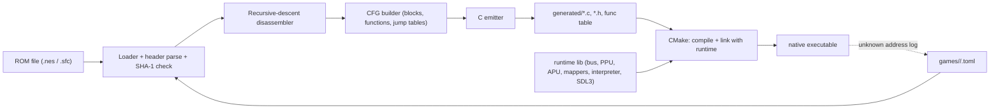

# DragonRecomp — Architecture Specification

Status: draft v0.3. Platform-specific details live in
[NES_SPEC.md](NES_SPEC.md), [SNES_SPEC.md](SNES_SPEC.md), [GB_SPEC.md](GB_SPEC.md), and [GBA_SPEC.md](GBA_SPEC.md).

## 1. Goals

- Statically translate NES (6502), SNES (65816), Game Boy / Game Boy Color
  (Sharp SM83), and Game Boy Advance (ARM7TDMI) game code into portable C99,
  compiled natively (Linux and Windows supported) together with a runtime.
- Hybrid model (à la N64Recomp + RT64): the **CPU is recompiled**, everything
  else (PPU, APU, DMA, mappers, timers, SPC700) is **emulated accurately** by
  the runtime.
- Correctness first: a game must behave identically to a cycle-reasonable
  emulator. Performance is a secondary concern (it is trivially sufficient).
- Never ship copyrighted data: ROMs are read at build/run time from the user's
  local copy, verified by SHA-1. Generated C is derived output and is never
  committed.

Non-goals (for now): macOS packaging, enhancements (widescreen, hi-res),
netplay, save states (may come later via `CpuState` + device snapshots).

## 2. Pipeline



1. **Load**: parse header (iNES/NES 2.0, SNES internal header), check SHA-1
   against the config, map PRG banks into a guest address model.
2. **Disassemble**: recursive descent from seeds — hardware vectors
   (RESET/NMI/IRQ/BRK; on SNES native+emulation vectors), config
   `entry_points`, jump-table targets, and addresses learned from the
   interpreter-fallback log.
3. **Build CFG**: basic blocks → functions. A function starts at any `JSR`/`JSL`
   target, vector, or configured entry point. Blocks reachable only via
   branches/`JMP` belong to the function that reaches them; a block reachable
   from two functions is duplicated (tail-shared code) or split into its own
   function and tail-called, selected by config/heuristic.
4. **Emit C**: one C function per guest function; each basic block becomes a
   label; intra-function branches become `goto`.
5. **Build**: the generated sources are compiled with the runtime into one
   executable per game.
6. **Iterate**: at runtime, any jump to an address with no compiled function
   falls back to the interpreter and is logged; the user adds it to the TOML
   and regenerates.

## 3. Repository layout

| Path | Contents |
|------|----------|
| `common/` | Shared C++20 libs: logging, TOML loading, file I/O, hashing, CFG utilities |
| `nes/recompiler/` | `nesrecomp` tool |
| `nes/runtime/` | NES runtime: CpuState, bus, PPU, APU, mappers, interpreter, SDL3 frontend |
| `nes/games/<game>/` | `<game>.toml` + `generated/` (gitignored) |
| `snes/recompiler/`, `snes/runtime/`, `snes/games/<game>/` | SNES equivalents |
| `gb/recompiler/`, `gb/runtime/`, `gb/games/<game>/` | Game Boy / Game Boy Color equivalents |
| `gba/recompiler/`, `gba/runtime/`, `gba/games/<game>/` | Game Boy Advance equivalents |
| `studio/` | DragonRecomp Studio (ImGui frontend, auto-pipeline & packager) |
| `docs/` | Specs |
| `.agents/skills/` | Agent skills |

## 4. Generated code conventions

### 4.1 Naming

| Symbol | Meaning |
|--------|---------|
| `func_XXXX` | Function at CPU address `$XXXX` in fixed (non-banked) space, e.g. `func_8000` |
| `func_BB_XXXX` | Function in switchable bank `BB` (NES mapper bank / SNES 24-bit bank), e.g. `func_03_A1F0`. On SNES all functions use the banked form (`func_00_8000`). |
| `func_XXXX_mY_xZ` | SNES only: variant compiled for M=Y, X=Z flag state (see SNES_SPEC) |
| `L_XXXX` | Basic-block label inside a function |
| `data_XXXX` | (optional) named constants for ROM tables referenced by the emitter |

Names are always uppercase hex, zero-padded. Config may attach a human name
(`name = "NMI_Handler"`); the emitter then emits a `#define`/comment alias but
the canonical symbol stays address-based.

### 4.2 Function signature and state

```c
typedef struct CpuState CpuState;
void func_8000(CpuState *cpu);
```

All guest state lives in `CpuState`; generated functions never use globals.
Memory access goes through bus callbacks/inlines provided by the runtime:

```c
/* NES (6502) — illustrative, final layout in nes/runtime/include */
typedef struct CpuState {
    uint8_t  a, x, y, s;      /* registers; stack is page $01 */
    uint16_t pc;              /* only meaningful at fallbacks/interrupts */
    /* flags kept unpacked for speed: c, v, i, d are 0 or 1 */
    uint8_t  c, v, i, d;
    /* lazy N/Z: normally n = z = last result byte.
       N = (n & 0x80) != 0, Z = (z == 0). BIT sets n = M, z = A & M. */
    uint8_t  n, z;
    uint64_t cycles;          /* master CPU cycle counter */
    uint64_t next_event;      /* cycles at which runtime must be polled */
    void    *bus;             /* opaque runtime pointer */
} CpuState;

uint8_t  bus_read (CpuState *cpu, uint16_t addr);
void     bus_write(CpuState *cpu, uint16_t addr, uint8_t value);
```

Rules:
- Reads of known **ROM** addresses with a fixed bank may be folded into direct
  array reads (`rom_fixed[addr - 0xC000]`); reads of known **RAM**
  (`$0000-$07FF` on NES) may use `cpu_ram[addr & 0x7FF]` directly. Anything
  else (I/O registers, mapper space, unknown) **must** go through `bus_read` /
  `bus_write` so side effects (PPU/APU registers, mapper writes) happen.
- Dummy reads/writes with side effects (e.g. RMW double-write, indexed
  page-cross dummy read) are emitted only when the target is I/O space.

### 4.3 Flags

- Flags are stored **unpacked** (one byte each, lazy N/Z through the `n`/`z`
  result bytes; SNES uses 16-bit `n`/`z` plus the current width). Packing into a P byte
  happens only on `PHP`, `BRK`/interrupt push, and on fallback to the
  interpreter; unpacking on `PLP`/`RTI`.
- The emitter may perform **dead-flag elimination** within a basic block:
  a flag write is dropped if the flag is overwritten before any read and
  before the block exits. Across block boundaries flags are always
  materialized (conservative). This optimization must be switchable
  (`--no-flag-opt`) for debugging.

### 4.4 Cycle accounting

- Every instruction adds its base cycle count to `cpu->cycles`; page-crossing
  and taken-branch penalties are added dynamically when not statically known.
- Batching: cycles of a basic block may be summed and added at block entry,
  **except** that any bus access to I/O space must observe the precise cycle
  count at the time of the access. The emitter therefore flushes the
  accumulated count before every I/O access (`cpu->cycles += n;` then the call).
- Device synchronization is "catch-up": the runtime's `bus_read`/`bus_write`
  for I/O first advances PPU/APU to `cpu->cycles`, then performs the access.
- At every backward branch, `JSR`/`RTS` boundary and function entry, generated
  code checks `if (cpu->cycles >= cpu->next_event) runtime_poll(cpu);` which
  advances devices and delivers pending NMI/IRQ. Interrupt delivery calls the
  vector's function **synchronously** (nested C call), emulating push of PC/P,
  and returns into the interrupted code when `RTI` executes.
- Cycle precision target: exact per instruction for NES (needed for sprite-0
  hit loops and raster effects); SNES uses master clocks (6/8/12 per access
  depending on region; see SNES_SPEC).

### 4.5 Control-flow translation

| Guest construct | Translation |
|---|---|
| Conditional branch / `JMP abs` within function | `goto L_XXXX;` |
| `JMP abs` to another function's entry | tail call: `func_YYYY(cpu); return;` |
| `JSR abs` / `JSL long` | push return address on the **guest** stack (so stack-inspecting code works), then `func_YYYY(cpu);` |
| `RTS` / `RTL` | pop return address; if it equals the expected return address → `return;` else → **RTS trick** path (below) |
| `RTI` | pop P + PC, `return;` (interrupts are nested C calls) |
| `JMP (ind)`, `JMP (abs,X)`, computed `RTS` | `runtime_dispatch(cpu, target)` |

**Dispatch** (`runtime_dispatch`): looks up `target` (and current bank mapping)
in a generated sorted table `{addr, bank, fnptr}`; on hit calls the function;
on miss logs `UNKNOWN_TARGET pc=$XXXX from=$YYYY` and runs the **interpreter**
until control returns to the caller (stack depth below entry) or reaches an
address that has a compiled function.

**Jump tables** are declared in config (address, count, entry format: `word`,
`word_minus_one` for RTS tables, split `lo`/`hi` tables, `long` for 24-bit).
Their targets become function seeds, and the emitter turns the indirect jump
into a `switch` on the index when the indexing pattern is recognized, falling
back to `runtime_dispatch`.

**RTS tricks** (push address-1 then `RTS`; e.g. SMB's `JumpEngine` at
`JSR` + inline table): the guest stack is always maintained, so a mismatched
`RTS` is handled by: pop the real address, `+1`, `runtime_dispatch`. When
"return value" functions manipulate the stack to skip their caller (`PLA PLA RTS`),
the C call stack would become out of sync; this is detected statically
(stack-height analysis) or at runtime (return address mismatch) and handled via
`longjmp`-free unwinding: each function returns a status code only in such
annotated functions (`stack_tricks = [...]` in config). Default: plain `void`.

Inline data after `JSR` (e.g. SMB `JumpEngine` tables) is declared in config so
the disassembler does not decode it as code.

### 4.6 Interpreter fallback

- A full, accurate interpreter of the guest CPU lives in the runtime and shares
  `CpuState`, bus and cycle accounting with the generated code.
- Used for: dispatch misses, self-modifying code / code executing from RAM,
  and optionally as a reference (`--interpret-only`, `--verify` lock-step mode
  that runs both and compares state after each function — debugging tool).
- Every fallback entry logs once per address (`fallback.log`, plus stderr):
  `FALLBACK addr=$XXXX bank=$BB from=$YYYY` so the address can be added to
  `entry_points` in the game TOML.

## 5. Game config (TOML schema)

```toml
[game]
name     = "Super Mario Bros."
platform = "nes"                # "nes" | "snes"
rom      = "../../../roms/nes/smb.nes"   # relative to the toml, or overridden by CLI
sha1     = "ea343f4e445a9050d4b4fbac2c77d0693b1d0922"
mapper   = 0                    # NES only; SNES: map = "lorom" | "hirom"

[output]
dir         = "generated"       # relative to the toml (gitignored)
split_every = 200               # functions per .c file

# Extra function seeds (beyond hardware vectors)
[[entry_points]]
addr = 0x8212
bank = 0                        # optional, for banked mappers
name = "GameEngine"             # optional

# Jump tables
[[jump_tables]]
addr   = 0x8E04
count  = 4
format = "word"                 # word | word_minus_one | split | long
# for format = "split": lo = 0x...., hi = 0x....

# Ranges that are data, never decode as code
[[data_ranges]]
start = 0x8000
end   = 0x8010                  # inclusive

# JSR followed by inline data (e.g. JumpEngine-style)
[[inline_data_calls]]
target = 0x8E04                 # the subroutine that consumes inline data
kind   = "jump_engine"          # table of words follows the JSR until next known code

# Functions that manipulate the stack to return past their caller
stack_tricks = []

# SNES only: initial/forced M/X flag states per function
# [[mx_hints]] addr = 0x008000, m = 1, x = 1
```

Unknown keys are an error (catch typos). The loader lives in `common/`.

## 6. Runtime overview

- `main` → load ROM (SHA-1 check) → construct `Bus` (mapper, RAM, PPU, APU,
  input) → reset → call `func_<RESET>` (does not return; the game loops forever).
- Frame pacing: the PPU signals frame completion; the runtime presents the
  framebuffer through SDL3 and throttles to 60.0988 Hz (NTSC NES) when polling.
- Audio: APU produces samples at native rate, resampled to 48 kHz into an SDL3
  audio stream.
- Input: SDL3 keyboard/gamepad → controller shift registers.
- No exceptions or allocations in hot paths (bus, PPU/APU step, generated code).

## 7. Testing strategy

- Unit tests (CTest): opcode semantics/cycles against tables; interpreter vs
  known vectors; config parser.
- CPU validation: nestest (`nestest.log` comparison) through the interpreter,
  and recompiled where possible; blargg `instr_test`, `cpu_timing_test`,
  `ppu_vbl_nmi`, `sprite_hit_tests`.
- Game-level: lock-step `--verify` mode, screenshot/frame-hash regression of
  scripted input movies (later).
