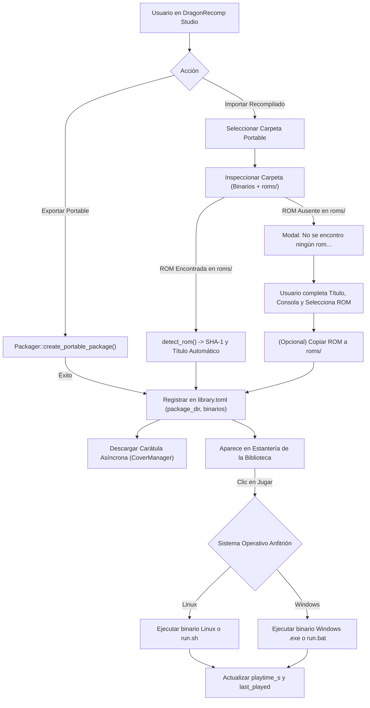

# Spec 004: Biblioteca Basada en Portables e Importación de Recompilados

> **Estado**: IMPLEMENTADA Y VERIFICADA  
> **Fecha**: 2026-11-17  
> **Alcance**: DragonRecomp Studio (`studio/src/app.cpp`, `studio/src/library.cpp`, `studio/src/library_view.cpp`, `studio/src/packager.cpp`, `studio/include/studio/library.h`, `studio/tests/library_tests.cpp`).

---

## 1. Resumen Ejecutivo y Motivación

Actualmente, **DragonRecomp Studio** agrega automáticamente cualquier archivo ROM a la biblioteca (`library.toml`) en el momento en que el usuario lo abre o arrastra en la interfaz (`load_rom`). Esto presenta serias deficiencias de diseño:

1. **Juegos no terminados en la biblioteca**: Si un usuario simplemente prueba una ROM, experimenta con configuraciones o cancela el proceso, la entrada queda permanentemente registrada en su biblioteca aunque jamás haya exportado un ejecutable funcional.
2. **Re-compilación innecesaria al hacer clic**: Al pulsar en una tarjeta de la biblioteca, Studio invoca nuevamente `load_rom()`, cambiando a la vista de recompilación y recompilando el juego desde cero, en lugar de **ejecutar el juego portable** que ya fue generado.
3. **Imposibilidad de importar juegos recompilados previamente**: Si un usuario tiene juegos ya exportados en carpetas independientes (en su disco o compartidos por otros usuarios), no puede agregarlos a su biblioteca sin tener que volver a abrir la ROM original y pasar por todo el pipeline de análisis y recompilación.

Esta especificación rediseña el ciclo de vida de la biblioteca de DragonRecomp Studio:
- **Regla de oro de adición**: Los juegos **solo** aparecen en la biblioteca una vez que han sido **exportados exitosamente como portables** o **importados** desde una carpeta existente.
- **Ejecución directa**: Al hacer clic en un juego de la biblioteca, se ejecuta inmediatamente el binario nativo portable correspondiente al sistema operativo anfitrión (Linux o Windows).
- **Importador de recompilados con diagnóstico de ROM**: Permite seleccionar una carpeta portable existente, detecta automáticamente ejecutables y ROMs en `roms/`, y si no se encuentra la ROM original, muestra la alerta:  
  `"No se encontro ningún rom en la carpeta correspondiente, llena los datos del juego manualmente"`  
  ofreciendo un asistente interactivo para registrar el título, plataforma y enlazar la ROM requerida.

---

## 2. Requisitos Funcionales

### RF-001: Desacoplamiento de Carga de ROM y Biblioteca
- `StudioApp::load_rom()` **NO** debe invocar `library_.add_rom()`.
- La vista de Recompilación (`StudioView::Recompiler`) se reserva exclusivamente para inspeccionar, depurar, configurar y recompilar ROMs activas.
- La biblioteca solo registrará entradas cuando:
  1. El usuario complete la exportación portable mediante el modal de empaquetado (`Packager::create_portable_package()`).
  2. El usuario importe exitosamente una carpeta de juego recompilado existente.

### RF-002: Modelo de Datos Extendido para `GameEntry`
La estructura `GameEntry` en `studio/include/studio/library.h` se amplía para registrar las rutas del paquete portable y los ejecutables específicos de cada plataforma:

```cpp
struct GameEntry {
    std::string sha1;                       // Hash SHA-1 de la ROM original
    std::string title;                      // Título visible del juego
    std::string platform;                   // "nes" | "snes" | "gb" | "gbc" | "gba"
    std::filesystem::path rom_path;         // Ruta al archivo ROM original (si está disponible)
    std::filesystem::path package_dir;      // Ruta raíz de la carpeta portable exportada/importada
    std::filesystem::path executable_linux;  // Ruta relativa o absoluta al binario ejecutable de Linux
    std::filesystem::path executable_windows;// Ruta relativa o absoluta al binario .exe de Windows
    GameMode mode = GameMode::Native;       // Native | Interpreter
    int64_t playtime_s = 0;                 // Tiempo acumulado de juego en segundos
    int64_t last_played = 0;                // Timestamp UNIX de la última sesión
    std::filesystem::path cover_path;       // Ruta local a la carátula (.png/.jpg)
    GameSettings settings;                  // Configuración de pantalla, volumen, filtros
};
```

### RF-003: Persistencia en `library.toml` con Retrocompatibilidad
El formato TOML de `library.toml` serializará los nuevos campos:
```toml
[[game]]
sha1 = "6b47bb75d16514b6a476aa0c73a683a2a4c18765"
title = "Super Mario World"
platform = "snes"
package_dir = "/home/derian/JUEGOS/RECOMP/SMW_Linux"
executable_linux = "Super_Mario_World"
executable_windows = "Super_Mario_World.exe"
rom_path = "/home/derian/JUEGOS/RECOMP/SMW_Linux/roms/smw.sfc"
mode = "native"
playtime_s = 7200
last_played = 1794964000
cover_path = "/home/derian/.config/dragonrecomp/covers/6b47bb75.png"
```
- **Retrocompatibilidad**: Si un archivo `library.toml` preexistente carece de `package_dir`, la entrada se preserva y se intenta resolver en la carpeta por defecto de exportación (`ExportedGames/`) o en la caché de Studio.

### RF-004: Registro Automático al Exportar Portable
- Cuando el usuario pulsa **"⚡ Exportar Ahora"** en el modal de exportación y `Packager::create_portable_package(opts)` devuelve `success == true`:
  - Se resuelve la carpeta del paquete generado (`result.package_path`).
  - Se registran los binarios creados:
    - Si se exportó para Linux: se identifica el ejecutable nativo o `run.sh`.
    - Si se exportó para Windows: se identifica el ejecutable `.exe` o `run.bat`.
    - Si se exportó para "Ambos": se registran ambas rutas.
  - Se llama a `library_.add_or_update_portable(...)` y se persiste de inmediato con `library_.save()`.
  - Si el juego no tiene carátula, se dispara la descarga asíncrona mediante `CoverManager`.

### RF-005: Ejecución Directa de Portables desde la Biblioteca
Al hacer clic en el botón principal **"▶ JUGAR"** o directamente sobre la carátula de un juego en la biblioteca:
1. **Detección del Sistema Operativo Anfitrión**:
   - En **Linux**:
     - Busca en primer lugar `executable_linux` o `package_dir / "run.sh"`.
     - Si existe, lo lanza directamente en segundo plano mediante `Pipeline::launch_portable_binary()` o proceso desacoplado.
     - Si solo existe ejecutable de Windows (`.exe`): notifica al usuario o consulta si desea ejecutarlo vía Proton/Wine.
   - En **Windows**:
     - Busca en primer lugar `executable_windows` o `package_dir / "run.bat"`.
     - Si existe, lo lanza mediante `ShellExecuteW` o `CreateProcessW`.
     - Si solo existe binario de Linux: notifica que el paquete requiere un entorno Linux.
2. **Registro de Telemetría**:
   - Al iniciar y terminar la sesión, actualiza `playtime_s` y `last_played`.
3. **Acción Secundaria "Abrir en Recompilador"**:
   - En el menú contextual `[...]` de cada tarjeta, se añade la opción **"🛠 Abrir en Recompilador"** para aquellos usuarios que deseen volver a analizar la ROM o modificar sus ajustes de emisión C99.

---

### RF-006: Asistente de "Importar Recompilado"
Se agrega un botón destacado en la cabecera de la Biblioteca: **`[ 📥 Importar Recompilado ]`**.

```
+----------------------------------------------------------------------------------------------------+
| 🐉 DRAGONRECOMP STUDIO         [ 📚 Biblioteca ]   [ ⚙ Recompilador ]       [ 📥 Importar Recompilado ] |
+----------------------------------------------------------------------------------------------------+
```

Al pulsar este botón:
1. Se abre el diálogo del sistema para **seleccionar una carpeta** (`on_import_folder_picked`).
2. El sistema inicia la inspección profunda de la carpeta seleccionada (`InspectPortableFolder`).

### RF-007: Detección Automática de Componentes en la Carpeta
La función inspectora verifica:
1. **Ejecutables**:
   - Linux: binario nativo (ELF), `run.sh`.
   - Windows: binario `.exe` (PE), `run.bat`.
2. **Subcarpeta `roms/`**:
   - Inspecciona `package_dir / "roms"`.
   - Busca archivos con extensiones válidas: `.nes`, `.sfc`, `.smc`, `.gb`, `.gbc`, `.gba`.
   - Si encuentra un archivo ROM, ejecuta `detect_rom(path)`.
   - Si la ROM es válida y su hash coincide:
     - Extrae título limpio, plataforma y SHA-1.
     - Registra automáticamente el juego en la biblioteca sin requerir pasos adicionales.
     - Muestra un banner verde: `✔ ¡Juego importado exitosamente: <Título>!`.

### RF-008: Alerta y Modal de Entrada Manual por Falta de ROM
Si la carpeta seleccionada contiene un ejecutable pero la carpeta `roms/` está **vacía**, no existe o no contiene una ROM reconocida:
1. Se abre un diálogo modal centrado con título: **"Importar Juego Recompilado"**.
2. Muestra un aviso de advertencia destacado:
   > ⚠️ **No se encontro ningún rom en la carpeta correspondiente, llena los datos del juego manualmente.**
3. Presenta el formulario interactivo para completar los datos faltantes:
   - **Título del juego** (campo de texto editable, inicializado con el nombre de la carpeta).
   - **Plataforma** (desplegable: NES, SNES, Game Boy, Game Boy Color, Game Boy Advance).
   - **Ejecutable detectado** (desplegable o texto con el archivo `.exe` o binario Linux hallado en la carpeta).
   - **Archivo ROM original** (selector de archivo con botón `[ 📁 Seleccionar ROM... ]`).
   - **Casilla de verificación**: `[X] Copiar archivo ROM a la carpeta 'roms/' del paquete`.
4. Botones de acción:
   - **`[ ✔ Guardar e Importar ]`** (se habilita cuando se han llenado los datos mínimos).
   - **`[ Cancelar ]`**.

---

## 3. Mockup de Interfaz de Usuario (Modal Manual)

```
+------------------------------------------------------------------------------+
| ⚠️ Importar Juego Recompilado                                             [X] |
+------------------------------------------------------------------------------+
|                                                                              |
|  [!] No se encontro ningún rom en la carpeta correspondiente,               |
|      llena los datos del juego manualmente.                                  |
|                                                                              |
|  Carpeta seleccionada:                                                       |
|  /home/derian/JUEGOS/RECOMP/Super_Mario_Bros_Linux                           |
|                                                                              |
|  Título del juego:                                                           |
|  [ Super Mario Bros.                                                       ] |
|                                                                              |
|  Plataforma original:                                                        |
|  [ NES (Nintendo Entertainment System)                                   v ] |
|                                                                              |
|  Ejecutable del juego:                                                       |
|  [ Super_Mario_Bros (Linux x86_64)                                       v ] |
|                                                                              |
|  ROM original requerida:                                                     |
|  [ /home/derian/ROMS/NES/Super Mario Bros (USA).nes    ] [ 📁 Explorar... ] |
|                                                                              |
|  [X] Copiar copia legal del ROM a la carpeta 'roms/' del paquete portable    |
|                                                                              |
|  --------------------------------------------------------------------------  |
|                                                                              |
|            [ Cancelar ]               [ ✔ Guardar e Importar ]              |
+------------------------------------------------------------------------------+
```

---

## 4. Arquitectura de Componentes y Flujo de Datos



---

## 5. Criterios de Aceptación y Pruebas

1. **Prueba de Carga Inicial**: Arrastrar una ROM a la vista de Recompilación no añade ninguna entrada a `library.toml`.
2. **Prueba de Exportación**: Exportar un juego (ej. *Adventure Island*) genera la carpeta portable y añade inmediatamente la tarjeta a la estantería correspondiente en la Biblioteca con sus rutas de ejecución guardadas.
3. **Prueba de Lanzamiento**: Pulsar "JUGAR" en la tarjeta de un juego exportado en Linux arranca el binario compilado/run.sh sin abrir la pantalla de recompilación.
4. **Prueba de Importación con ROM**: Seleccionar una carpeta portable que ya contenga su ROM en `roms/` importa el juego automáticamente con título y plataforma correctos.
5. **Prueba de Importación sin ROM (Alerta Manual)**: Seleccionar una carpeta portable con `roms/` vacía despliega el modal con el mensaje exacto:  
   `"No se encontro ningún rom en la carpeta correspondiente, llena los datos del juego manualmente"`, permitiendo guardar la entrada tras indicar título, consola y ROM.
6. **Pruebas Automatizadas**: Crear un test unitario en `studio/tests/library_tests.cpp` verificando:
   - `test_library_portable_entry()`
   - `test_library_import_auto()`
   - `test_library_import_manual_fallback()`
